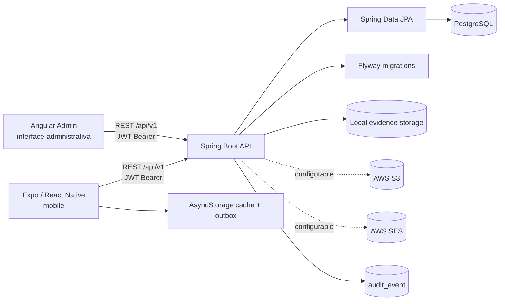
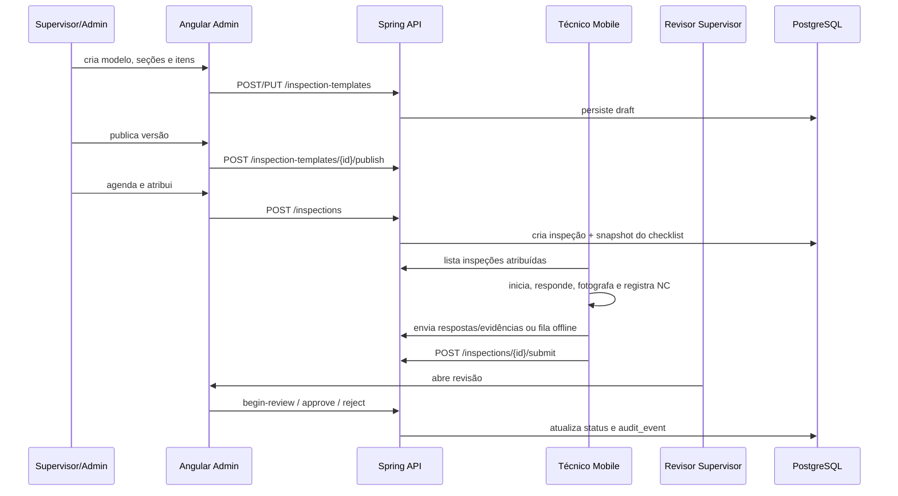

# Arquitetura observada

## Visão geral

Evidências: `API/src/main/java/com/fieldops/`, `API/src/main/resources/application.yml:1-57`, `interface-administrativa/src/environments/environment.ts:1-4`, `mobile/src/api/config.ts:14-29`.

## Camadas do backend

O backend é organizado por contexto: `auth`, `user`, `client`, `site`, `equipment`, `template`, `inspection`, `evidence`, `review`, `audit`, `dashboard`, `sync` e `shared`. Em cada domínio aparecem combinações de `controller`, `application`, `domain`, `repository`, `dto` e `mapper`. Os controllers expõem REST; services aplicam regras; entidades JPA representam o modelo; repositories encapsulam consultas; DTOs formam os contratos.

O tratamento transversal inclui `GlobalExceptionHandler`, `ApiError`, `RequestCorrelationFilter` e `BaseEntity` (`API/src/main/java/com/fieldops/shared/`).

## Segurança e autorização

O login/refresh/logout e recuperação de senha ficam em `/api/v1/auth`. O `JwtAuthenticationFilter` lê `Authorization: Bearer`, valida access token e carrega o usuário; `SecurityConfig` e `@PreAuthorize` controlam acesso. A API aplica permissões por papel e, no serviço de inspeção, restringe o técnico/supervisor ao vínculo da inspeção (`InspectionService.java:208-224,267-333`).

O admin usa `authGuard`, `roleGuard` e `passwordChangeGuard` (`interface-administrativa/src/app/app.routes.ts:1-26`). O mobile guarda somente refresh token em SecureStore e aceita apenas `TECHNICIAN` (`mobile/src/auth/AuthContext.tsx:7-14,27-33,95-105`).

## Dados e evidências

O schema começa em V1 e recebe sessões de refresh (V2), recuperação de senha (V3) e sincronização mobile (V4). Evidência é recebida por multipart, validada e armazenada por uma abstração `EvidenceStorage`; o modo padrão é local e S3 é selecionável por configuração (`application.yml:22-28`).

## Tratamento de erros

O backend diferencia `BusinessRuleException`, `ConflictException`, `ForbiddenOperationException` e `NotFoundException`, convertendo-os para `ApiError` por handler global. O mobile diferencia `OfflineError` e `HttpError`; um 401 tenta renovar tokens uma vez e repete a requisição (`mobile/src/api/client.ts:68-151`).

## Fluxo de inspeção

## Principais endpoints

- Auth: `POST /auth/login|refresh|logout|forgot-password|reset-password|change-password`, `GET /auth/me`.
- Cadastros: `/users`, `/clients`, `/clients/{id}/sites`, `/sites/{id}/equipment`, `/equipment/by-qr/{qrCode}`.
- Modelos: `/inspection-templates`, draft, sections, items, publish e versions.
- Inspeções: `/inspections`, assign, cancel, start, submit, reopen-correction, responses e history.
- Evidências: `/inspections/{id}/evidence` e content.
- Revisão/NC: begin-review, approve, reject e `/non-conformities`.
- Mobile: `/mobile/sync/push` e `/mobile/sync/pull`.
