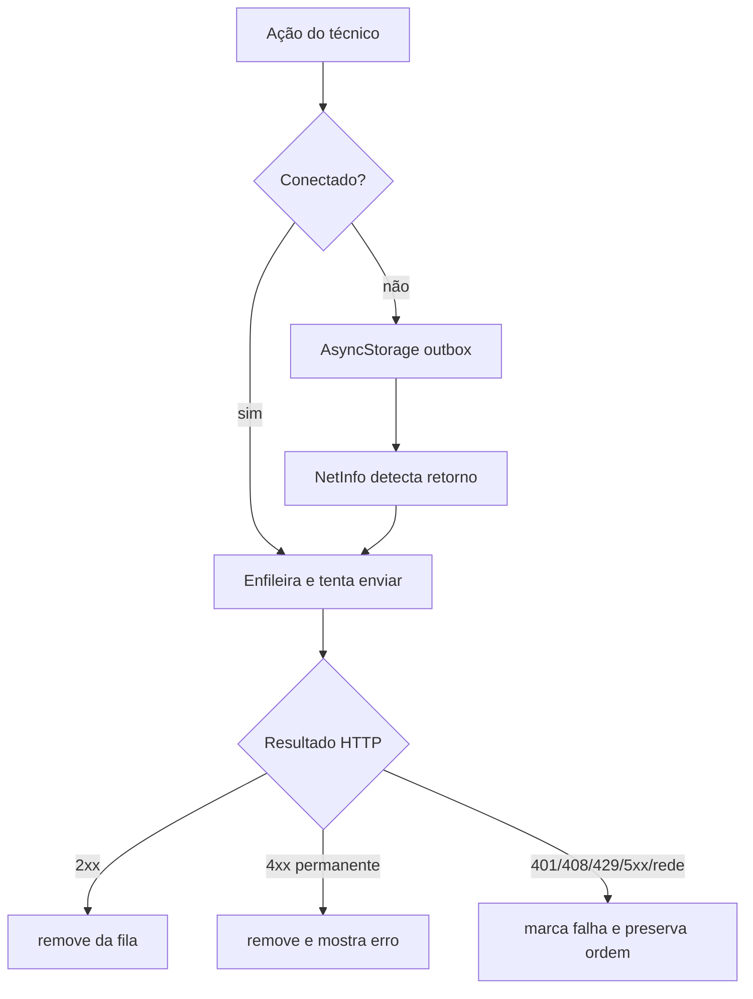

# Fluxos de negócio

## 1. Preparação

1. Admin/supervisor cadastra cliente, local e equipamento.
2. Admin/supervisor cria um modelo em draft.
3. Adiciona seções e itens com tipo de resposta e regras de observação/evidência.
4. Publica uma versão.

Evidências: controllers e `TemplateService`; painel `features/templates/`; endpoints em `TemplateController.java:27-138`.

## 2. Planejamento

1. Admin/supervisor cria a inspeção.
2. A API valida os vínculos e exige uma versão publicada/ativa.
3. A inspeção nasce `ASSIGNED`.
4. A API materializa o snapshot do checklist e registra eventos de auditoria.

Evidência: `InspectionService.java:67-153`; `InspectionController.java:27-100`.

## 3. Execução

1. O técnico vê suas inspeções.
2. Inicia uma inspeção atribuída.
3. Responde itens e pode registrar observação, não conformidade e foto.
4. O mobile pode enfileirar escrita offline.
5. Ao finalizar, o técnico envia a inspeção.

O mobile implementa `start`, `answer`, `evidence`, `nonConformity` e `submit` na outbox (`mobile/src/offline/queue.ts:15-27`, `SyncContext.tsx:35-56`).

## 4. Revisão

1. Supervisor inicia a revisão de uma inspeção enviada.
2. Aprova ou reprova com motivo/comentários.
3. Uma inspeção rejeitada pode voltar para correção pelo técnico.

Evidências: `ReviewController.java:23-53`, `ReviewService.java`, telas admin `features/inspections/review/`.

## 5. Sincronização offline

A regra de parada em erro transitório preserva a ordem; a implementação está em `mobile/src/offline/SyncContext.tsx:28-135`. O servidor registra operações e mudanças em V4, `SyncService.java` e `SyncController.java`.

## Estado e limitações

O fluxo de negócio está coberto por testes de autenticação, workflow de inspeção, versionamento de template e sync. O mobile não possui suíte E2E visível no repositório; portanto, o comportamento de câmera, permissões, armazenamento físico e retorno de rede foi confirmado pelo código e typecheck, não por device real nesta auditoria.
