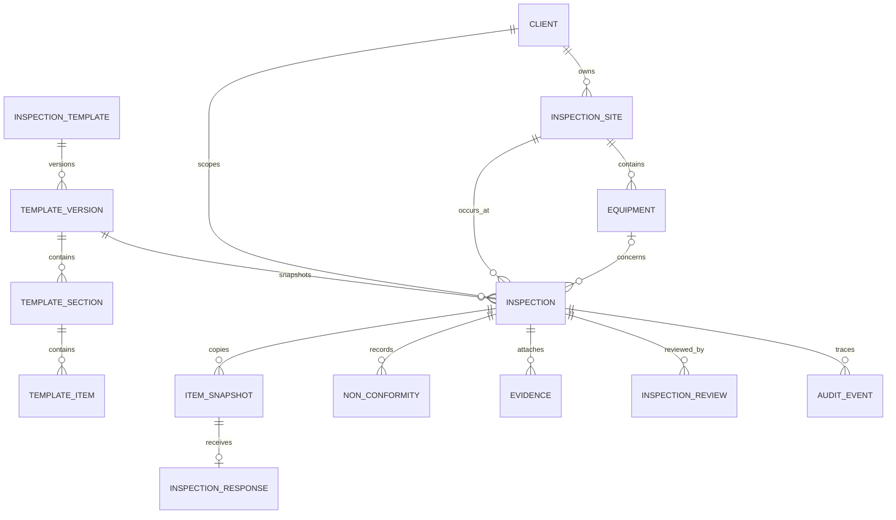

# Modelo de dados

## Entidades confirmadas

| Entidade/tabela | Relações principais | Evidência |
|---|---|---|
| `app_user` | cria, executa, supervisiona e audita | `V1__init.sql:3-17` |
| `client` | possui locais | `V1:19-31` |
| `inspection_site` | pertence a cliente; possui equipamentos | `V1:33-52` |
| `equipment` | pertence a local; possui QR único | `V1:54-73` |
| `inspection_template` | possui versões | `V1:75-88` |
| `inspection_template_version` | possui seções; publicada/ativa | `V1:90-104` |
| `template_section` | possui itens ordenados | `V1:106-116` |
| `template_item` | tipo, obrigatoriedade e regras JSON | `V1:118-134` |
| `inspection` | aponta para versão, cliente, local, equipamento, técnico e supervisor | `V1:136-168` |
| `inspection_item_snapshot` | copia o checklist no momento da inspeção | `V1:170-190` |
| `inspection_response` | uma resposta por item snapshot | `V1:192-212` |
| `non_conformity` | ligada à inspeção e opcionalmente ao item/resposta | `V1:214-232` |
| `evidence` | ligada à inspeção, resposta ou NC | `V1:234-260` |
| `inspection_review` | decisões de revisão da inspeção | `V1:262-275` |
| `audit_event` | eventos por inspeção/entidade/ator/requestId | `V1:277-295` |
| `refresh_session` | sessões rotativas por usuário | `V2__refresh_sessions.sql:1-12` |
| `password_reset_token` | recuperação expirável | `V3__password_recovery.sql:1-14` |
| `sync_operation` | idempotência por usuário/dispositivo/operação | `V4__mobile_sync.sql:1-21` |
| `sync_change` | cursor/sequência de mudanças para pull | `V4__mobile_sync.sql:23-32` |

## Relacionamentos

## Regras observadas

- Só cliente, local, equipamento e usuários ativos e compatíveis podem compor uma inspeção (`InspectionService.java:67-111`).
- Uma nova inspeção exige versão publicada e ativa do modelo; itens são copiados para snapshot (`InspectionService.java:98-153`).
- Status observados: `DRAFT`, `ASSIGNED`, `IN_PROGRESS`, `SUBMITTED`, `UNDER_REVIEW`, `APPROVED`, `REJECTED`, `CANCELED`.
- Só o técnico vinculado inicia, responde e envia; supervisor/admin planejam/cancelam; supervisor revisa (`InspectionController.java`, `ReviewController.java`, `InspectionService.java:267-331`).
- O envio valida itens obrigatórios e a revisão bloqueia transições inválidas.
- `inspection_response.inspection_item_id` é único, evitando duas respostas para o mesmo item.
- QR de equipamento é único; site deve pertencer ao cliente e equipamento ao site.
- V4 garante idempotência de sync com `(user_id, device_id, operation_id)`.

## Não encontrado

Não há entidade separada confirmada para cliente-usuário, plano de ação de NC, relatório PDF, comentário de revisão ou portal de cliente no código auditado. Esses itens podem aparecer em Docs como ideia, requisito ou evolução, mas não devem ser apresentados como implementados.
